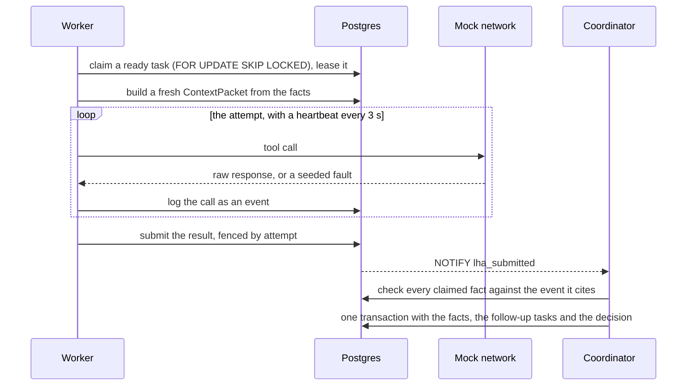
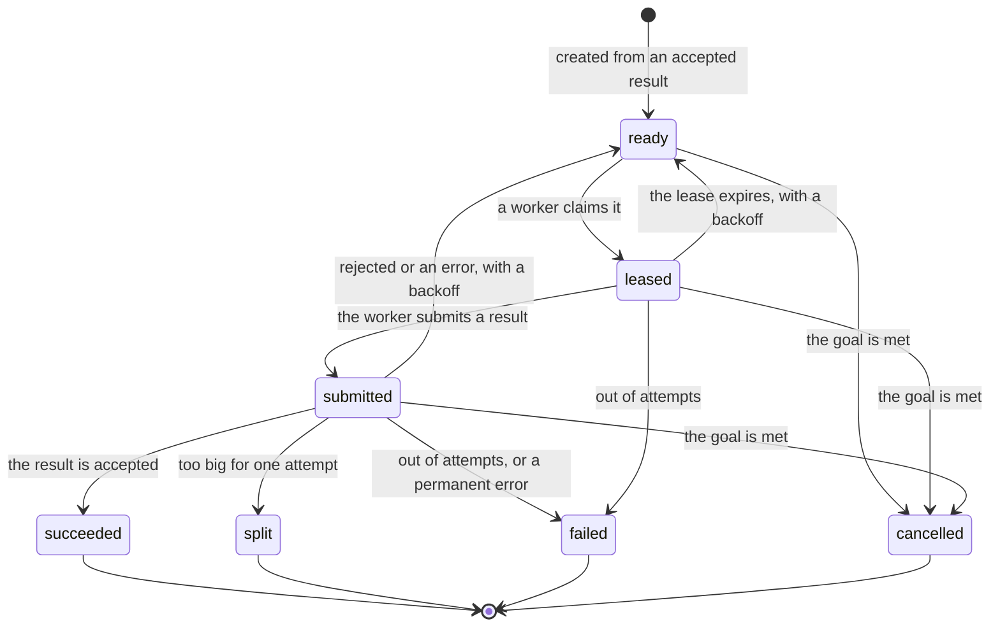

# Design

## What this is

This document explains how the system works and why it is built the way it is. The README is the short version, and [NOTES.md](../NOTES.md) is the look-back on the decisions, what is still not built and how the project was made. Every claim about the code points to the file and the lines where it happens, so it can be checked.

## The goal the agents pursue

The agents audit a mock cloud deployment for replica drift and write a finding that has been verified. A few words need explaining before anything else. A host is a fake server in the mock network (`host-1`, `host-2` and so on), and hosts are what the agents explore. A service is a program running on a host (`payments`, `search`, `cache`), and its replicas are how many copies of it are running at the same time, much like pods in Kubernetes. The registry is one file, `registry.json`, on one host, which lists how many replicas each service should have, and it is the 'source of truth' the agents compare against. A drift is a service running a different number of replicas than the registry says. A document is a text file on a host (such as `runbook.md`, a team's operations notes), and documents can mention other hosts, which is the only way hidden hosts are found. A stale read is when the mock server answers with an old, out-of-date value, like a cache that hasn't refreshed, and a fresh read is simply asking the same question again with a new call. A decoy is a service that looks drifted because of a stale read but matches the registry on a fresh read. Lastly, the scorer is the code that runs at the end (`lha/core/scoring.py`, lines 31–49), which builds the world again from the seed and compares the report's findings with the planted drifts, and the supervisor then prints PASS or FAIL (`lha/run.py`, lines 331–348).

The small example below shows the idea.

```
THE MOCK NETWORK  (fake servers the agents explore)

host-1  └─ file registry.json         the "should be" list:
                                      payments 3 · search 2 · cache 3
host-2  └─ payments: 3 replicas       ✓ matches
host-3  ├─ search: "1 replica"        ? mismatched because the first answer
        │                             was stale (out of date)
        │  ask again → 2 replicas     ✓ matches, it was a decoy
        └─ file runbook.md:           the only clue that host-4 exists
           "cache runs on host-4"
host-4  └─ cache: 1 replica           ✗ registry says 3 → this is the drift
           ask again → 1 replica      ✓ confirmed

report: "cache on host-4 runs 1 replica; the registry expects 3"
        evidence: the registry fact + the two read events (by ID)
```

The agents start knowing only `host-1`, `host-2` and `host-3`, and the example is simplified, because a real run has 20 hosts, between about 65 and 90 services, 3 decoys and one dead reference, which is a document naming a host that doesn't exist (`lha/domains/audit/world.py`, lines 88–172). Two more hosts make trouble on purpose (`lha/domains/audit/world.py`, lines 121–127). The wide host runs 40 services, which is too many to read in one attempt's context window, so its discovery has to be split into batches, and the outage host is down for every task of the first round, so its circuit breaker opens and a later round has to bring it back. The outage host is always a leaf, meaning a host whose documents name no other host, so no part of the network is only reachable through it. Documents are served in pages of 40 lines (`lha/domains/audit/world.py`, lines 33 and 175–187), because in a big world `registry.json` lists hundreds of services and would not fit in any context window in one piece, and it has one entry per line, so every page can be read on its own.

There are two goals, chosen with `--goal` (`lha/domains/audit/__init__.py`, lines 62–76). The default goal, 'one', plants exactly one drift and is met as soon as that drift is verified, because coverage is a measure we report and not what counts as success, so a run that finds and verifies the drift early is a good run. The 'find all drifts' goal, 'all', plants three drifts (`lha/config.py`, line 59) and is met only when no host is left unexplored and every service has a verdict, meaning a clean compare, a verified drift or a refuted one (`lha/domains/audit/rules.py`, lines 351–398). That gives a longer and more predictable horizon, because the run cannot end until it has read everything.

The run is long for three reasons. First, the deepest planted drift sits at the end of a chain of documents that starts at one of the deepest other hosts, 5–6 hops from the start in total, and because discovery works breadth-first the chain is only entered after most of the network has been explored (`lha/domains/audit/world.py`, lines 101–119), so the run cannot end in a handful of steps. Second, some services look drifted on the first read because of a stale response but match the registry when checked again, so a claim only counts once a second, independent read agrees with it. Lastly, faults happen everywhere, as tool calls time out, return 500 errors or return an empty 200 (a 'silent success'), the outage host is down, model output is sometimes malformed or made up, workers and the coordinator can be crashed on purpose, and the whole run can be killed in the middle and resumed. Altogether a run takes roughly 250–500 steps at the default fault rate, about 470–530 for the 'find all drifts' goal, and up to about 660 at a 45% fault rate, which is what we measured over runs across many seeds and fault rates, and a run takes 10–15 seconds without injected crashes.

This is not the only task the system runs, because the general parts (the tables, the task queue with its leases and fencing, the context packet builder, the retry rules, the circuit breaker and the scorer) know nothing about networks, and three more domains run on exactly the same core, verified research with `--domain research`, on a mock web or, with a real model, on the real web, code work with `--domain code`, on a mock repository or, with a real model, on a real one, and batch extraction with `--domain extract`, on mock invoices or, with a real model, on a real folder of documents. How the core and the domains are kept apart is described under 'Core and domains' below.

## Scope

The `v1` tag in the repository marks the first core that was built end to end, which is the mock network with its seeded world and faults, the tables with task claiming, leases and fencing, the `ContextPacket` builder, three agents with fake models, verification by two agreeing reads, retries and replanning, the goal check, the reporter, the scorer, and `--kill-at` with `--resume`. Since then the system has gained a benchmark against a naive agent, a circuit breaker per host, stall detection that re-opens work that was put off, the coordinator as its own process with automatic restarts and an advisory lock, injected crashes of workers and of the coordinator, splitting of tasks too big for one attempt, a tool that fetches an earlier raw output by its pointer, the 'find all drifts' goal, documents served in pages, `LISTEN/NOTIFY` instead of polling, a plan split between several coordinators, a benchmark of all of this at scale, migrations with Alembic, a one-command docker compose, a live dashboard, a core that knows nothing about the audit, with verified research as a second domain on it, which also runs on the real web, code work on a git repository as a third, which also runs on a real repository, and batch extraction from a folder of documents as a fourth, which also runs on a real folder, real models as an opt-in next to the fake one, with task instructions and a money budget, and an `lha` command and an MCP server, which is a process that offers tools to an assistant over the Model Context Protocol, so runs can be started in the background and read back from a terminal or by an assistant such as Claude Code. Everything in this document describes the code as it is now.

Some things are designed but not built, and they are named where they come up. A search of `lha/` finds no code for `depends_on` between tasks planned ahead of their inputs or for running the processes on more than one machine, and although the code can run on a real model, no test, benchmark or CI step ever calls one.

## The coordinator, in plain words

The coordinator is an ordinary loop and not an AI (`lha/core/coordinator.py`, lines 115–144). It is easiest to think of it as a project manager with a to-do board, which is the `tasks` table, and a notebook of findings, which is the `facts` table, and the loop below is what it does over and over.

```
loop:
  1. look at tasks workers just finished
       - output invalid?          → reject it, put the task back (retry)
       - too big for one attempt? → split it into batches
       - output valid?            → save its facts, mark the task done
  2. plan follow-ups from new facts
       - new host found           → "discover host X"
       - service read             → "compare service Y with the registry"
       - mismatch found           → "verify service Y" (read it again)
  3. handle trouble
       - task failed too often    → give up on it, try another route
       - host failing again and again → open its circuit breaker
       - worker went silent       → put its task back on the board
       - nothing moved for a while → re-open work that was put off
  4. check the goal
       - met → create the reporter task, cancel all leftover tasks
  5. stop when the report is written (a partial one if the run ran out)
```

Workers never decide what happens next. They pick a task off the board, do it and hand back a result, and the coordinator decides what that result means.

The diagram below follows one task from the moment a worker claims it to the moment the coordinator decides what its result means.



## Roles and task types

**The coordinator is plain code that owns the plan.** It checks and commits worker output, creates follow-up tasks, retries, splits, replans and decides when the goal is met, and its own output is tasks and logged decisions (`lha/core/coordinator.py`).

**Discovery is the 'breadth' role.** Given a host name, it reads the host's services and documents and reports what exists, which services run how many replicas and which other hosts the documents mention, and the coordinator records that as facts (`lha/domains/audit/agents.py`, lines 54–108). A batch of a split discovery reads only what it was given, which is a few of the host's services, one document or one page of a document.

**Analysis is the 'depth' role.** Given a service and its registry entry, it compares the discovered replica count with the registry and raises a drift hypothesis, and in a verify task it reads the service again with a fresh call and reports the number, which the coordinator uses to move an `inferred` drift towards `verified` or `refuted` (`lha/domains/audit/agents.py`, lines 161–198).

**The reporter runs once, at the end.** It writes the finding from verified facts only and lists every verified drift with the ID of its fact, and the supervisor saves its summary as `finding.md` (`lha/domains/audit/agents.py`, lines 227–261; `lha/run.py`, lines 331–348).

Several worker processes run side by side, by default two for discovery, two for analysis and one for the reporter (`lha/run.py`, lines 56–59), and `--workers N,M` sets how many there are for the first two roles (`lha/run.py`, lines 560–563). Workers never talk to each other and share findings only through the fact table, and each task's prompt is built from the latest facts at the moment a worker claims it, so nobody misses anyone else's findings.

Every task has a type, and each type belongs to exactly one role (`lha/domains/audit/__init__.py`, lines 44–59), so a worker only claims tasks of its own role (`WHERE role = :role`), and each type has its own input and output schema (`lha/domains/audit/tasks.py`, lines 16–103). There are four types. `discover_host` belongs to discovery, takes a host name (and for a batch, its services, document or page and its part number) and returns the services with their replica counts, the documents and the hosts they mention. `compare_service` belongs to analysis, takes a service and its host, works from the service's read fact and registry entry in its context packet, makes no network call, and returns either a match or a drift claim that the coordinator records as an `inferred` drift fact. `verify_drift` also belongs to analysis, takes the service and host of an `inferred` drift and returns the replica count from a fresh read. `write_report` belongs to the reporter, takes only a flag saying whether the report is partial, works from the verified drift facts in its context packet, and returns a list of findings with a summary.

Tasks are only created once their inputs exist. The coordinator creates a follow-up task from an accepted result, so a task never has to wait for another one, and `compare_service` is only created once both the service's read and the registry entry exist as facts. Until the registry is found no compare work is created, and when the registry fact arrives the coordinator creates a compare for every service already read (`lha/domains/audit/rules.py`, lines 97–113). Each task records `parent_task_id`, which is the task whose result created it (`NULL` for the starting tasks, the report task and work re-opened after a stall), and that gives the plan's tree of tasks for auditing.

## Verification ('checked twice')

A drift goes through three stages (`lha/domains/audit/rules.py`, lines 137–198). First, discovery's read of the service is read number one, a `compare_service` task compares it with the registry, and a mismatch becomes an `inferred` drift fact, which does not count yet. Second, the coordinator creates a verify task that any analysis worker can pick up, which reads the service again with a fresh call and reports the number it saw without deciding anything. Lastly, the coordinator decides, and two reads must agree, so if the fresh read agrees with the first the drift becomes `verified`, and if they disagree neither read is trusted and a third read breaks the tie (2 out of 3). If the majority matches the registry, the drift becomes `refuted`, which means it was a decoy.

The second read is not automatically the truth, because it could be stale or broken too, and what counts is agreement between independent reads. A read that matches the registry is accepted after one read, and so is the registry itself, and stale reads in the mock world only ever make a service look drifted and never hide a real drift (`lha/domains/audit/app.py`, lines 39–42), which is a simplification of the world and not of the checks.

The verify read also updates the service's read fact, superseding the stale one. That does not trigger a second compare, because `compare_service:search@host-3` already exists, so creating it again does nothing (see `task_key` below). Verify rounds are capped at 3 per drift (`lha/config.py`, line 12), and a drift still undecided after that stays `inferred` and never counts, unless stall detection gives it one more round later. Only verified facts can meet the goal or appear in the report, which is what stops one bad read (a stale cache, a silently broken tool, a malformed model output) from ending up as the answer.

## Storage

Every table's primary key is a UUIDv7, generated in Python in a few lines (`lha/ids.py`, lines 13–25), because Python 3.11 and Postgres 16 have no built-in v7. A v7 UUID starts with a timestamp, so sorting by `id` is sorting by creation time while the ids stay globally unique. `created_at` uses `clock_timestamp()` and not `now()` (`lha/db/models.py`, lines 24–26), because `now()` returns the same time for every row in one transaction and the coordinator creates several tasks per transaction.

There are four tables, and every table apart from `sessions` has a `session_id`. The `sessions` table has one row per run, with the domain, the goal and its kind, the starting points (hosts in the audit), the seed, the size of the world, the fault rate, the crash rate, the number of coordinators, how processes wait for work (`notify` or `poll`), the world (`mock`, `web` for the real web, `repo` for a real repository or `docs` for a real folder of documents), the parameters a domain keeps for itself, such as a session's repository and its check, the model, its context window and the money budget for a real one, the step budget, the status (`running`, `succeeded` or `failed`) and the accepted report (`lha/db/models.py`, lines 28–54). The `events` table is an append-only log of everything that happens, meaning context packets, model calls, tool calls with their raw responses, errors, injected crashes, fact changes and coordinator decisions, with the columns `id`, `session_id`, `task_id`, `attempt`, `actor`, `kind`, `payload` (jsonb) and `created_at` (`lha/db/models.py`, lines 56–71). Workers, the coordinator and the supervisor (which logs the start and any resume of a session and every restart of the coordinator, `lha/run.py`, lines 167–170, 283 and 312) all write to it, and it is never put into a prompt as a whole. The `tasks` table is the work queue and the plan (`lha/db/models.py`, lines 73–100), and the `facts` table holds the structured findings with where they came from and their status (`lha/db/models.py`, lines 102–122), written only by the coordinator and kept to one current row per `(subject, key)`.

The schema is built by migrations with Alembic, which is a tool that keeps a numbered list of schema changes and records in the database which of them it has already applied, so every run brings the database up to the newest schema before it starts, and a database made by an older version of the code is upgraded in place instead of being dropped (`lha/db/migrate.py`, lines 42–52). The first revision creates the four tables and a trigger on `tasks` that is described under 'Waking up' below (`lha/db/migrations/versions/0001_initial.py`, lines 21–36 and 39–154), and a database made before there were migrations already has exactly that schema, so it is marked as being at the first revision and upgraded from there. The upgrade runs under an advisory lock, because the benchmark starts several runs at once. `just migrate revision "<what changed>"` writes a new revision from the difference between `lha/db/models.py` and the database, and a test fails when the two differ without a revision (`tests/test_migrations.py`).

## Task queue and leases

Tasks are added during the run as results come in, and a new task is created as `ready`, because its inputs already exist (`lha/db/crud.py`, lines 82–123). Workers claim ready tasks with `SELECT … FOR UPDATE SKIP LOCKED`, which is Postgres's building block for job queues. It is really two instructions, and the skipping is done by the query that is running and not by anyone else. `FOR UPDATE` says 'I am going to change the rows I am selecting, so lock them for me', and until that transaction ends nobody else can lock or change them. `SKIP LOCKED` says 'while I am looking, if a row is already locked by someone else, don't wait for it and leave it out of my results'. When two workers ask at the same moment with tasks A, B and C ready, it goes like this.

```
worker 1: SELECT … LIMIT 1 FOR UPDATE SKIP LOCKED  → gets A (A now locked)
worker 2: SELECT … LIMIT 1 FOR UPDATE SKIP LOCKED  → A is locked → skip → gets B
```

Without `SKIP LOCKED`, worker 2 would wait for worker 1's transaction to finish before moving on, so workers would queue up behind each other, and without `FOR UPDATE` nothing would be locked, so both workers could read A as `ready` and both claim it, and the task would run twice. Together, every worker gets a different task and nobody waits. The real claim query is one statement, so one transaction (`lha/db/crud.py`, lines 128–141).

```sql
UPDATE tasks SET status = 'leased', leased_by = :worker,
       lease_expires_at = now() + make_interval(secs => :lease)
 WHERE id = (
   SELECT id FROM tasks
    WHERE session_id = :sid AND status = 'ready' AND role = :role
      AND (not_before IS NULL OR not_before <= now())   -- respect backoff
    ORDER BY created_at, id
    LIMIT 1
    FOR UPDATE SKIP LOCKED)
RETURNING id, task_key, parent_task_id, type, attempt, input, scope
```

The columns of a task are its `id` (a UUIDv7 such as `0192f7a1-…`), its `session_id` (such as `3f2b9c1e-…`), its `task_key` (such as `discover_host:host-4`, unique per session), its `type` and `role` (such as `discover_host` and `discovery`), its `input` in jsonb (such as `{"host": "host-4"}`), its `scope`, which is what the context builder selects facts for (such as `["host:host-4", "*@host-4"]`), its `parent_task_id`, its `status` (such as `ready`), its `attempt` and `max_attempts` (such as `1` and `3`), its `leased_by` and `lease_expires_at` (such as `discovery-2` and `2026-10-03 14:02:41+00`), its `not_before`, which is the time before which it cannot be claimed (a backoff, a new round's delay or an open circuit breaker), its `resource`, which is what it works on (such as `host-4`) and which its circuit breaker and its partition are keyed on, its `partition`, which says which coordinator decides its results (see 'Processes, crashes and resume'), its `result` in jsonb, which is the worker's submitted output before the coordinator accepts it, and its `submitted_at` time, which measures how long a result waits for its coordinator (`lha/db/models.py`, lines 73–100).

The `task_key` makes creating a task idempotent, meaning doing it twice has the same effect as doing it once. Two documents can both mention `host-4`, and a restarted coordinator may repeat a decision it already made, but a unique constraint on `(session_id, task_key)` together with `ON CONFLICT DO NOTHING` means the same task is never created twice (`lha/db/models.py`, line 97; `lha/db/crud.py`, line 120). It is also the stable name used to seed faults (see 'Determinism'). The key is a readable string of the form `<type>:<what it's about>`, built from the task's input (`lha/domains/audit/tasks.py`, lines 109–131), so discovering a host is `discover_host:host-4`, the second of three batches of a split discovery is `discover_host:host-7/2of3`, comparing a service is `compare_service:cache@host-4`, verifying a drift is `verify_drift:cache@host-4#1` and then `#2` for the tie-break, and writing the report is `write_report`. The `task_key` is not the `id`, because the `id` is new for every row and every run, so it cannot seed faults or catch a duplicate, while the `task_key` describes what the task is and is the same every time, and the `id` is for joins and references. A retry is the same row with `attempt + 1` and the same key, while a deliberate new round of the same work (a tie-break verify, or a host tried again in a second round) gets a `#n` suffix, so it is a new row with a new key.

There is no explicit 'unlock', because a row lock lasts until the transaction ends, and what keeps the task claimed after that is the lease, meaning the status `leased` plus `lease_expires_at`. While a worker runs a task, a background asyncio task inside the worker extends the lease every 3 s, which is shorter than the 10 s lease so one late beat isn't fatal (`lha/config.py`, lines 4–5; `lha/core/worker.py`, lines 139–146). In SQL terms the heartbeat is the update below (`lha/db/crud.py`, lines 163–180).

```sql
UPDATE tasks SET lease_expires_at = now() + interval '10 seconds'
 WHERE id = :task_id AND leased_by = :worker AND attempt = :attempt
   AND status = 'leased';
```

If a worker dies, its heartbeats stop and the lease expires, and on every loop the coordinator selects the expired leases and sends each task through the same retry rule as any other failure, so it goes back to `ready` with `attempt + 1`, or to `failed` and the replan rules once it has used up `max_attempts` (`lha/core/coordinator.py`, lines 379–396). When the supervisor sees a worker process exit, it knows the worker is dead, so it sets that worker's lease to expire at once instead of waiting up to 10 s (`lha/run.py`, lines 177–196), and the task still goes through the coordinator's usual rule. If a worker was only slow, its next heartbeat or result submission matches 0 rows because the `attempt` changed, so the worker drops its result, which stops a late 'zombie' worker from overwriting the retry's work. The heartbeat loop is started when the worker claims a task and cancelled when it submits, and `attempt` acts as a fencing token, which is a number that goes up every time the task is handed out, so an old holder can always tell it has been replaced.

```
t=0   worker A claims task T          attempt=1, lease until t=10
t=2   A's tool call hangs; heartbeats stop
t=10  lease expired → coordinator: task T ready, attempt=2
t=11  worker B claims task T          attempt=2
t=15  A wakes up, submits "attempt=1" → matches 0 rows → A discards its result
t=16  B submits "attempt=2"           → accepted
```

`leased_by` alone is not enough, because the same worker could claim the task again later under a newer attempt. Cancelling needs no extra code either. When the goal is met, the coordinator sets every leftover task to `cancelled`, including ones a worker is running right now, and that worker's next heartbeat or submit has the same `AND status = 'leased'` condition, so it matches 0 rows and the worker stops and throws its result away.

Every task moves through the same statuses, shown below, and only the coordinator moves a task out of `submitted`.



### Waking up

Processes don't poll for work. A trigger on `tasks` sends a Postgres notification, which is a short message on a named channel that every connection listening on that channel receives, when a task becomes ready, on the channel `lha_ready` with the session and the role, and when a result is submitted, on the channel `lha_submitted` with the session and the partition (`lha/db/migrations/versions/0001_initial.py`, lines 21–36). A notification sent inside a transaction is only delivered when that transaction commits, so a process that is woken always finds the row it was told about. Each worker and each coordinator holds one extra connection that listens for its own role or partition (`lha/db/notify.py`, lines 23–54). A worker that finds no work waits for a notification, or until the next backed-off task becomes due, because nothing announces the end of a backoff, and never longer than 1 s (`lha/core/worker.py`, lines 74–82; `lha/db/crud.py`, lines 149–160), and a coordinator waits for a submitted result or 0.5 s, so it still sweeps expired leases and checks the goal (`lha/core/coordinator.py`, lines 115–144; `lha/config.py`, lines 56–57). `--poll` turns this off, so every process looks for work every 50 ms instead (`lha/config.py`, line 55), which the scale benchmark uses for comparison.

## Who writes what

Workers write `events` (every model call and tool call, tagged with `task_id` and `attempt`) and their own task's `result`, and they never write facts, which keeps 'LLMs propose, code decides' true at the database level. A worker submits with one fenced update that sets `status = 'submitted'` and `result = <output>` where `id`, `attempt` and `status = 'leased'` still match (`lha/db/crud.py`, lines 183–198), and a failed attempt is submitted the same way with `result = {"error": {"kind": "timeout", ...}}` (`lha/core/worker.py`, lines 148–206).

The coordinator then checks `result` against the task type's schema and checks every claimed fact against its source (`lha/core/coordinator.py`, lines 223–242; `lha/domains/audit/rules.py`, lines 44–74). A read must cite a tool-call event from this same attempt, and the value must appear in that event's raw response (`lha/core/coordinator.py`, lines 246–268; `lha/core/domain.py`, lines 37–45). A discovery must also report every service the host listed and every page of every document, or for a batch exactly the services, documents or page it was given, so an attempt cannot quietly leave something out (`lha/domains/audit/rules.py`, lines 324–332). A drift claim must cite the read fact and the registry fact it compares, and the coordinator does the comparison again itself (`lha/domains/audit/rules.py`, lines 137–161), and a report must list exactly the verified drifts, each matching its fact (`lha/domains/audit/rules.py`, lines 201–217). A made-up host or number fails these checks. Only then, in one transaction, does it write the facts, mark the task `succeeded`, create the follow-up tasks and log the decision in `events`, while an error result or an invalid one goes through the retry rules instead. If the coordinator crashes halfway, the transaction rolls back and the task is still `submitted`, so after a restart it is simply processed again, and there is never a state where facts exist but their follow-up tasks don't.

## Facts

Raw tool output goes into `events` in full, and that is what pointers refer to. The agent's result lists the facts it read, each citing the event it came from, and the coordinator checks them as above. A fact is one small, typed claim with an `id` (a UUIDv7 such as `0192f7a3-…`), a `session_id` (such as `3f2b9c1e-…`), a `subject` (such as `service:cache@host-4`), a `key` (such as `config.replicas`), a `value` in jsonb (such as `1`), a `status` (`observed`, `inferred`, `verified`, `refuted` or `superseded`), a `source_task_id` and `source_event_id` saying which task and which tool call produced it, an `evidence` list in jsonb holding the reads behind a drift fact, and a `created_at` time (such as `2026-10-03 14:02:11+00`).

The fact names used in this domain are `host:<h>` (with the keys `exists`, `listing` and `unreachable`), `service:<s>@<h>` (with `config.replicas`, `drift.replicas` and `verdict`), `doc:<name>@<h>` (with `mentions` and `pages`, and `doc:<name>#<page>@<h>` with `mentions` for each later page) and `registry:<s>` (with `replicas`) (`lha/domains/audit/facts.py`), while the core keeps each host's circuit breaker as `resource:<h>` with the key `breaker` (`lha/core/coordinator.py`, line 68). A host's `listing` is the services and documents it listed when it was read, which is how the 'find all drifts' goal knows whether everything on a host has been read. Each service has two main kinds of fact. A read has `key = config.replicas`, a value such as `1` and the status `observed`, and a drift claim has `key = drift.replicas`, a value such as `{"expected": 3, "actual": 1}` and a status that moves from `inferred` to `verified` or `refuted`.

Facts are never deleted. A fact's `status` can change, for example from `inferred` to `verified` or to `superseded`, and every change is also written to `events` (`lha/db/crud.py`, lines 238–348), so the full history is always there, with `events` being the strictly append-only table. The current facts are the ones with `status <> 'superseded'`, and `refuted` facts stay visible, because 'we checked this and it was wrong' is useful knowledge.

The same fact means the same `(session_id, subject, key)`, and a partial unique index lets the database itself guarantee at most one current fact per key (`lha/db/models.py`, lines 115–122).

```sql
CREATE UNIQUE INDEX facts_one_current
    ON facts (session_id, subject, key)
 WHERE status <> 'superseded';
```

The index is a rule and not storage, so it doesn't keep, sort or return rows, and all it does is make Postgres refuse any write that would leave two current rows for the same key. Reading the current fact therefore needs no `ORDER BY created_at DESC LIMIT 1`, and the query below returns at most one row, with the index making it fast (`lha/db/crud.py`, lines 223–231).

```sql
SELECT * FROM facts
 WHERE session_id = :sid AND subject = :subject AND key = :key
   AND status <> 'superseded';
```

As an example, discovery's first read of `search` hit a stale answer of 1, and a later fresh read says 2, which leaves two rows.

```
row  subject                key              value  status
A    service:search@host-3  config.replicas  1      superseded
B    service:search@host-3  config.replicas  2      observed   ← current
```

Inserting another `superseded` row for this key is allowed, but inserting another `observed` row while row B is current fails with the Postgres error `duplicate key value violates unique constraint "facts_one_current"`, so replacing a fact is one transaction that marks the old row `superseded` and then inserts the new one. When the coordinator writes a fact, the same value does nothing, so retries change nothing, a different value marks the old fact `superseded` and inserts the new one, and a new value that contradicts a `verified` fact is never written silently, because `upsert_fact` raises `FactConflict` (`lha/db/crud.py`, lines 256–259) and the coordinator treats the whole result as rejected and retries the task (`lha/core/coordinator.py`, lines 224–228).

When the coordinator creates a task it sets its scope, which is the list of subjects the task is about, such as `host:host-3` and everything on that host, or for a batch of a split discovery only its own services (`lha/domains/audit/tasks.py`, lines 134–150). The context builder selects the current facts whose subject is in scope, with a plain SQL filter and no embeddings or similarity search, and a compare or verify task's scope already names the service's registry entry, while for the reporter it also adds the registry entry and the latest read behind each verified drift (`lha/core/context.py`, lines 122–163).

The tables grow, and that is fine, because it is storage and not prompt, and Postgres handles millions of rows. Facts grow with the size of the world and not with the number of steps, because a newer fact with the same `(subject, key)` supersedes the old one. Retention and archiving are out of scope for this project.

A step is one model call or one tool call. Each one is logged as an event, so the step count is a count of those events and is the same from every process (`lha/db/crud.py`, lines 22–23 and 53–55), while heartbeats are not events.

## Processes, crashes and resume

`just start` runs a supervisor (`lha/run.py`), which starts the mock network, the coordinators and the worker processes as separate operating system processes and then watches them (`lha/run.py`, lines 97–220). Every 50 ms it starts again any worker that died, starts a coordinator again if it crashed, checks `--kill-at`, and prints a progress line every 2 s (`lha/run.py`, lines 136–158). The coordinator is its own program (`lha/core/coordinator.py`, lines 610–622), and it ends with exit code 0 once the session is over, which is how the supervisor knows the run has finished.

The plan can be split between several coordinators with `--coordinators`, and each one is a partition, meaning it decides the results of only the tasks marked with its number (`lha/core/coordinator.py`, lines 162–173 and 379–396). A task's partition is a stable hash of its resource, which in the audit is its host (`lha/core/domain.py`, lines 194–203), so every fact about a host, its services and its documents is written by one coordinator, which keeps the rule of one writer per fact. Partition 0 is the leader, which also checks the goal, the budget and stalls, re-opens work and creates the report, while the others only process results and sweep their own expired leases (`lha/core/coordinator.py`, lines 481–488). Only one thing crosses partitions, which is the registry, because a read creates its compare only if the service's registry fact exists, and the registry creates compares for every read that exists, so a read and the registry committed by two coordinators at the same moment could each miss the other. Every discovery therefore takes a transaction-level advisory lock in shared mode, and the one that found registry entries takes it exclusively, so whichever commits second sees what the first committed (`lha/domains/audit/rules.py`, lines 123–134).

Before it does anything, each coordinator takes a Postgres advisory lock for its session and partition (`lha/core/coordinator.py`, lines 100–160). An advisory lock is a named lock that is not tied to any table, which one connection holds and which is released automatically when that connection closes, so a coordinator that dies, however it dies, lets go of it. The key is taken from the session ID and the partition, so nothing extra is stored, as in `pg_try_advisory_lock(hashtextextended('coordinator:' || :session_id || ':' || :partition, 0))`. A restarted coordinator that starts while an old one has not fully died waits for the lock, for up to 30 s (`lha/config.py`, line 64), so two coordinators never work on the same partition at the same time.

A coordinator that crashes is started again, and because its state is all in Postgres the new one simply picks up the `submitted` results and the expired leases. If one crashes 3 times in a row without a single decision being committed in between (`lha/config.py`, line 63), the supervisor treats that as a bug, such as one result that always crashes it, and not as bad luck, so it stops everything with exit code 2 and leaves the session `running` for `--resume` after the fix (`lha/run.py`, lines 160–175).

Crashes can be injected on purpose with `--crashes`, which is the share of task attempts that crash a process, and every injected crash is seeded like the other faults. A worker crashes after it has done the work and before it submits, which is the most wasteful moment, and half of these crashes make it exit holding its lease, while the other half make it hang, staying alive but silent for longer than its lease, after which it tries to submit and is fenced out (`lha/core/worker.py`, lines 98–137). The coordinator crashes after it has written a result's facts and follow-ups and before it commits, so the transaction rolls back and the next coordinator does that result again (`lha/core/coordinator.py`, lines 177–221). A result crashes a coordinator at most once, which is recorded in `events` in a transaction of its own, because an injected crash stands for bad luck and must not look like a crash loop.

`--kill-at N` makes the supervisor kill every process with SIGKILL once the step count reaches N and then exit abruptly with `os._exit` (`lha/run.py`, lines 406–413), which is the harshest crash, because tasks in flight are lost in the middle of their lease. `--resume` takes a session ID, or finds the latest unfinished session when none is given (`lha/run.py`, lines 289–297 and 356–372), starts everything again with that session's seed and settings, and carries on from Postgres. No worker from the old run is alive, so all of its leases are released straight away (`lha/run.py`, lines 300–313), and `submitted` results are processed. Nothing is replayed from memory, because nothing important lives in memory.

## Context packets

A `ContextPacket` is a Pydantic model built in memory at the start of each attempt at a task, from a fresh database query (`lha/core/schemas.py`; `lha/core/context.py`, lines 104–119), and it is the user prompt for every model call in that attempt, where the later calls see the same packet plus the results of the attempt's own tool calls (`lha/core/agent.py`, lines 279–301). Before the packet comes the task type's instructions, which are its system prompt and the same for every attempt of that type, such as telling a discovery to read every service and page its host lists and to cite the call each value came from (`lha/domains/audit/agents.py`, lines 42–51). The packet has four layers. The pinned layer holds the goal, whose text says what counts as done, and this task's spec, which is its type, key, attempt and input, and it is always included. The facts layer holds only the facts relevant to this task, such as this host or this service. The recent layer holds the last few events of this task, up to 5 in total, made of the coordinator's decisions about it (which carry the reason the previous attempt failed) and any lost leases (`lha/config.py`, line 42; `lha/core/context.py`, lines 166–183). The pointers layer says where raw outputs this task may reuse are, as the event ID, the tool and the path of each, but leaves the outputs themselves out (`lha/core/context.py`, lines 186–216).

A task may reuse the successful outputs of its own earlier attempts, and a batch of a split discovery may also reuse the outputs of the attempt that was too big, which had already read part of what the batch is about to read (`lha/db/crud.py`, lines 201–213), and a batch is only pointed at reads of its own services, documents and pages and holds only its own services' facts, so its pointers fit in its budget (`lha/core/context.py`, lines 186–216; `lha/domains/audit/__init__.py`, lines 138–152; `lha/domains/audit/tasks.py`, lines 134–150). The discovery agent fetches such an output with the `fetch_pointer` tool instead of calling the network again (`lha/domains/audit/agents.py`, lines 54–108), and the tool reads it from Postgres, so it has no faults, and logs the copy as a tool call of its own, so a fact can cite it (`lha/core/tools.py`, lines 84–98). The coordinator does not take the copy on trust, because before a copy counts as a source it checks that the original event exists, belongs to this task or its split parent, succeeded, and has exactly the same response (`lha/core/coordinator.py`, lines 246–287). A verify task never uses pointers, because its whole point is a fresh read.

The four layers are in order of priority from highest to lowest. The window, which is how much one model call may use, is 2000 tokens for the fake model and 32,000 for a real one unless `--window` says otherwise, and it is shared, with 20% kept back for the model's answer and 40% for the attempt's own tool calls and results, which leaves 40% for the packet, 800 tokens for the fake model (`lha/config.py`, lines 38–41; `lha/core/context.py`, lines 44–51). The instructions come out of the packet's share first, because they are shown with every packet and are never cut, and when the packet would be over what is left it is cut from the bottom up, so pointers go first, then the oldest recent events, then the oldest facts, and pinned is never cut. In practice the packet is built from the top down instead of being trimmed (`lha/core/context.py`, lines 61–101). The budget is the context window minus the tokens kept back, pinned goes in first, and then whole items go in by priority (facts newest first, then recent events newest first, then pointers) for as long as the next item still fits, with nothing ever cut in half and whatever was left out recorded in the packet's `omitted` counts, which are logged with the packet. As an example, with a budget of 10 and pinned taking 4, facts 4, recent 2 and pointers 1, the total would be 11, so pinned, facts and recent fit (10) and the pointer is left out, which gives the same result as 'drop the lowest item' but without a loop of cutting and recounting. Token counts are estimated at about 4 characters per token (`lha/core/context.py`, lines 54–58), which is close enough for a budget, and a real model's provider also reports the exact count, which is logged with each call.

A task can still be too big in two ways. If the pinned layer and the instructions alone don't fit the packet's budget, the worker fails the attempt with a permanent `context_overflow` error (`lha/core/context.py`, lines 75–77), because cutting pinned would silently change what the task is. More often the attempt's own tool results fill the window, as when discovery reads the wide host's 40 services one after another, and every model call, by the fake model or a real one, is first checked against the window less the answer's share, which is 1600 tokens for the fake model, and raises the same error once it is over (`lha/core/agent.py`, lines 161–165). The coordinator then splits the discovery into batches (`lha/domains/audit/rules.py`, lines 263–308 and 311–321), with 8 services in each batch of services and one batch for each document (`lha/config.py`, line 23), taking what the host lists from the failed attempt's own `get_host` response in `events` and not from anything the worker claimed, marks the original task `split`, and the batches run as tasks of their own. A document still too big for one attempt, such as the registry of a big world, is split again into one batch per page, where the number of pages comes from the failed attempt's own response for the first page. A batch of services or a single page that still doesn't fit is not split again and fails for good.

A packet is used for one attempt only and then thrown away. A copy is logged to `events` (`lha/core/worker.py`, line 175), so we can always see exactly what an agent saw, but the next attempt never starts from it and builds a fresh packet instead, because other workers have added facts since then, because the next attempt is usually a different task with a different scope, and because if the old packet held a bad or stale fact, rebuilding from the database picks up the correction while reusing the packet would carry the error forward. On a retry, the new packet's recent layer includes the reason the previous attempt failed, so the prompt grows with the task and not with the run's history.

Compaction, meaning shrinking what the model sees, happens on the prompt and never on the log, and it happens in three places. When raw tool output is written it is turned into facts, when a packet is read it goes through a relevance query and the budget, and any summary (such as the progress line, or the count of omitted facts) is worked out again by code from the facts (`lha/core/coordinator.py`, lines 590–607), so we never summarise a summary.

## Retries and replanning

The coordinator follows plain rules, applied in order.

**Tools retry first.** A short-lived tool error (a timeout, a 500 or 503, a 429, an empty 200 or a malformed body) is retried up to 2 more times inside the attempt, each try with a new `call_no` and so a new fault roll, and every try is logged (`lha/core/tools.py`, lines 100–120; `lha/config.py`, line 27). Only if it keeps failing does the attempt fail and reach the coordinator.

**Every failure is sorted into retryable or permanent.** Timeouts, 500s, 429s, empty 200s, invalid or rejected model output, a real model's API errors and expired leases are retryable, so the task goes back to `ready` after a backoff of `not_before = now() + 0.25 × 2^attempt s` (`lha/core/coordinator.py`, lines 332–359; `lha/config.py`, line 9; `lha/core/worker.py`, lines 199–202). A 404, meaning the host or service doesn't exist, a real web page that isn't text, and a `context_overflow` are permanent, so the task fails straight away because retrying won't help (`lha/core/coordinator.py`, line 64), except that a task that overflows is split first, as above, if its domain can split it. A 404 only counts as permanent when it is for what the task is about, which is its own host, or for a verify its own service, because a 404 for anything else means the model asked for something that doesn't exist, such as a made-up service name, and that says nothing about the task's host, so it is retried as a `wrong_call` (`lha/core/coordinator.py`, lines 334–337; `lha/domains/audit/__init__.py`, lines 112–119). The fake model never makes such a call, but a real one can.

**Each task gets `max_attempts = 3`.** After that it is `failed` (`lha/config.py`, line 8), and nothing downstream was ever created from it, because follow-ups only come from accepted results.

**A task that failed for good is replanned by a fixed rule per task type** (`lha/core/coordinator.py`, lines 361–377). A failed `discover_host` records a `host unreachable` fact and tries one more round later (`discover_host:host-4#2`), and a 404 records that the host doesn't exist and drops it. A failed `compare_service` tries once more later as a new round, and since it makes no network call, repeated failure means bad model output. A failed `verify_drift` schedules another verify round later, up to the cap of 3 rounds, and the drift stays `inferred` so it can't count yet. A failed `write_report` is retried, and if it keeps failing the session fails while the verified facts stay in the database. A task too big even after splitting is given up. New rounds wait 1 second before they can be claimed (`lha/config.py`, line 13), and every replan decision is written to `events` with its reason.

**Each host has a circuit breaker.** A circuit breaker is a rule that stops sending work to something that keeps failing, so the run doesn't waste its budget retrying one broken host. The coordinator counts failed network attempts in a row against each host, from discovery and verify tasks failing with a network error, and after 3 of them it opens the host's breaker for 3 seconds (`lha/config.py`, lines 16–17; `lha/core/coordinator.py`, lines 427–450). While the breaker is open, the task that tripped it, or its next round, waits until the cooldown ends and then goes first as the probe, which is the one task that tests whether the host is back, and every other task for the host, including new ones, waits another cooldown on top (`lha/core/coordinator.py`, lines 400–425). The next successful task for the host closes the breaker and releases everything it held (`lha/core/coordinator.py`, lines 452–477). The outage host shows the breaker at work in most runs, because its first-round discovery fails three attempts in a row, the breaker opens, and the second round, which goes as the probe, finds it back, unless the goal is met before the third attempt comes round.

**Stall detection re-opens work that was put off.** When no work is left and the goal is not met, or when no result has been accepted for 200 steps (`lha/config.py`, line 20; `lha/core/coordinator.py`, lines 535–551), the coordinator re-opens what was put off before it gives up (`lha/domains/audit/rules.py`, lines 401–441). That is one more round for hosts given up as unreachable, for drifts still `inferred` and for services that never got a verdict, plus batches for whatever a host listed but nobody has read, as long as nothing is already working on them. A re-opened task has a round past the usual cap, so its `task_key` is new, and a second re-open of the same thing does nothing because its key already exists, so the run can't loop. If there is nothing to re-open, the session ends and the reporter writes a partial report.

## Session lifecycle

The leader coordinator checks the goal at most every half second and not after each model call, because the check reads every current fact, and the check is plain code over the facts (`lha/config.py`, line 58; `lha/domains/audit/rules.py`, lines 338–398). For the 'one' goal it asks whether there is a `verified` drift fact backed by a registry fact, and for the 'all' goal it asks whether the registry has been found, every host any document mentions has been read or found not to exist, everything each host listed has been read, and every service read has a verdict. While the session is running, the coordinator keeps adding tasks as new facts unlock them, such as a new host leading to a read of its services. When the goal is met, the coordinator creates the reporter task and cancels the leftover tasks, and the reporter runs only now and reads only verified facts. The session has succeeded once the report is written and accepted with at least one finding (`lha/domains/audit/rules.py`, lines 201–217). The session fails when the step budget (3000 by default), the time limit (600 seconds by default, or 3 hours on a real model, set with `--max-seconds`) or, for a real model, the money budget (5 dollars by default, set with `--budget`) runs out, or when the run stalls with nothing to re-open (`lha/core/coordinator.py`, lines 481–529; `lha/config.py`, lines 47 and 54–56; `lha/run.py`, lines 571–575), and in all of these cases the reporter still runs, because it is exempt from the budget, and writes a partial report from what was verified.

## Models

Every agent runs on either the fake model or a real one, and the choice is made once, when the session starts, and kept on the session, so a resumed run uses the same model (`lha/core/agent.py`, lines 44–54; `lha/run.py`, lines 514–528). By default `--model` is 'auto' (or whatever the `LHA_MODEL` variable says), which picks a real model, Claude Sonnet through Pydantic AI, when `ANTHROPIC_API_KEY` is set, and the fake model when it isn't, so switching to a real model is a matter of setting the key, while `--model fake` or any Pydantic AI model name picks one by name (`lha/config.py`, lines 46–47). A real model needs its provider's package, which `uv sync --extra models` installs, and the supervisor builds the model before the run starts, so a missing package or key stops the run straight away instead of failing one task after another (`lha/run.py`, lines 316–328). Tests, CI and both benchmarks ask for the fake model by name, so a key in the environment never costs them anything (`tests/conftest.py`).

The fake model is a deterministic Python function plugged in through Pydantic AI's `FunctionModel`, and the agent loop, the tool calling and the output validation are real, so only the 'brain' is scripted (`lha/core/agent.py`, lines 227–243). It reads nothing but its prompt, because it parses the ContextPacket back out of the user prompt instead of being handed the packet, so it sees exactly what a real model would see (`lha/core/agent.py`, lines 246–253). The brain reacts to its input, because it is a rule-based policy and not a fixed tape, so for example the discovery policy reads every service and document of its host (or of its batch) that it hasn't read yet in this attempt, one call at a time, and fetches by pointer whatever an earlier attempt already read (`lha/domains/audit/agents.py`, lines 54–108), and the compare policy works from the facts in its packet (`lha/domains/audit/agents.py`, lines 161–180). It does not try to work around a failing tool, because a tool that keeps failing ends the attempt and the coordinator's retry rules take over.

Every call by either model goes through one wrapper, which checks the size of everything the model is shown against the window before the call and logs the call as a step afterwards, and for a real model it also logs the tokens the call used and what it cost, taken from Pydantic AI's price list, or from a high estimate for a model the list doesn't know, so the money budget always holds (`lha/core/agent.py`, lines 137–204 and 263–271; `lha/config.py`, line 50). The leader coordinator adds up the cost of every model call when it checks the budget (`lha/db/crud.py`, lines 61–67; `lha/core/coordinator.py`, lines 499–500). A real model is not deterministic, so what 'Determinism' below promises holds for the fake model only, although the world and each call's fault roll are still fixed by the seed whichever model runs.

Errors come from two sources. Tool errors come from the mock world, and the model never sees them, because the tool raises an error and the worker submits that error as the attempt's result (`lha/core/worker.py`, lines 148–206). Model errors are made on purpose for the fake model, where a seeded 5% of final answers are broken (`lha/config.py`, line 33), half of them malformed, meaning a field is missing, which Pydantic AI's output validation rejects, and half fabricated, meaning a valid schema with the wrong content (a replica count off by one, or a host no document names), which only the coordinator's source check catches (`lha/core/agent.py`, lines 197–204). A real model makes mistakes of its own, and they meet the same checks. Either way the task is retried and nothing bad reaches the facts.

## Determinism

Faults are pseudo-random but seeded, meaning they look random but are fixed by the seed, so different seeds give different fault patterns. Each fault decision comes from `hash(seed, task_key, attempt, call_no)`, which is a hash of the seed, the `task_key`, the attempt and the call number, and not from one shared random number generator, and the tools send `task_key`, `attempt` and the call number as HTTP headers (`lha/core/tools.py`, lines 122–151), so the mock network can decide without keeping any state. Injected crashes are rolled in the same way, from the seed, the `task_key` and the attempt (`lha/core/worker.py`, lines 129–137; `lha/core/coordinator.py`, line 198). The roll itself is a few lines, shown here without its docstrings and comments (`lha/faults.py`, lines 19–36).

```python
def roll(seed: int, *parts: object) -> float:
    text = "|".join(str(p) for p in (seed, *parts))
    digest = hashlib.sha256(text.encode()).digest()
    return int.from_bytes(digest[:8], "big") / 2**64


def pick_fault(r: float, fault_rate: float) -> str | None:
    if r >= fault_rate:
        return None
    index = int(r / fault_rate * len(FAULT_KINDS))
    return FAULT_KINDS[min(index, len(FAULT_KINDS) - 1)]
```

The roll is a number from 0.0 up to but not including 1.0 (0.0 ≤ x < 1.0), and a call fails when the roll is below the fault rate. It is a dice roll and not a rule about hosts, so `discover_host:host-4` doesn't always fail, because each call gets its own fixed roll and roughly `fault_rate` of all calls fail (0.15 by default, set with `--chaos`, `lha/config.py`, line 32). Nothing about faults is stored, because the mock network works out each roll from the request headers and the seed it got at startup, and the world itself (the hosts, the services, the drifts, the decoys, the wide host and the outage host) is also generated from the seed, so a resumed run and the scorer see exactly the same world. The code uses `hashlib` and not Python's `hash()`, because the built-in `hash()` of a string changes on every process start (`PYTHONHASHSEED`). Faults are still visible afterwards, because although the mock network writes nothing to Postgres (it plays the outside world), the tool records every error it got as an event. The roll uses the `task_key` and not the task's `id`, because the `id` is a fresh UUID in every run while `discover_host:host-4` is the same in every run. The `call_no` is the number of the tool call within one attempt (0, 1, 2 and so on), because one `discover_host` attempt makes several HTTP calls (get the host, get each service, fetch each document), and without `call_no` they would all share one roll and fail or succeed together. A retry gets a new roll, because a new `attempt` means a new hash, so a retry can succeed where the first try failed.

What 'same seed, same run' promises on the fake model is the same world, the same faults for each task attempt and the same outcome (PASS and the same findings). It does not promise an identical event log, because with workers running side by side the order of events still varies, and lease timeouts depend on the wall clock.

## The mock network

The mock network is its own FastAPI service (`lha/domains/audit/app.py`), and the tools make real HTTP calls to it, so it is a second boundary between processes. It has three endpoints, get host (its services and documents), get service (its replica count) and fetch document, which returns one page and the number of pages (`lha/domains/audit/app.py`, lines 21–56), and there is deliberately no 'list all hosts', so hidden hosts can only be found through documents, while the starting hosts come from the session. The fault middleware, seeded as above, returns 500s, 429s, timeouts and empty 200s, where the empty 200s are the silent failures, and the audit adds a rule that answers 503 for the outage host to every task of the first round, meaning every task key without a `#n` round suffix (`lha/core/world.py`, lines 41–59; `lha/domains/audit/app.py`, lines 14–19).

For timeouts, the client is our tool code, meaning the HTTP client (`httpx`) inside a worker that calls the mock network. For a timeout fault the server deliberately waits about 3 s and the client gives up after about 1 s and records a timeout (`lha/config.py`, lines 26 and 29), and keeping the client's limit short means a timeout costs a worker 1 s, so a full run takes about 10–15 seconds. For decoys, a few healthy services are marked as decoys, and reads from `discover_host` tasks get a stale replica count for them while reads from `verify_drift` get the true one, because the world reads the task type from the `task_key` header (`lha/domains/audit/app.py`, lines 39–42). Stale reads are never applied to a drifted service, which is a simplification, because real staleness can hide a drift too. Lastly, a 404 is not a fault, because it means the host or service doesn't exist and that is a valid answer, and telling a real 404 apart from a fault is part of what the tools check (`lha/core/tools.py`, lines 42–49 and 135–136).

## How the failure modes are handled

**Context going bad as the window fills is handled by never letting the raw log reach a prompt.** Each attempt gets a fresh `ContextPacket` within a budget (`lha/core/context.py`, lines 61–101), and a task whose own work doesn't fit is split (`lha/domains/audit/rules.py`, lines 263–308).

**Summaries of summaries drifting is handled by working every summary out again from the facts by code.** The progress line is rebuilt from the database each time (`lha/core/coordinator.py`, lines 590–607).

**Bad output poisoning the shared state is handled by checking every fact before commit.** Output is checked against its schema, every fact is checked against the tool response it cites, a copy fetched by pointer is checked against its original, and only `verified` facts count (`lha/core/coordinator.py`, lines 223–287; `lha/domains/audit/rules.py`, lines 44–74).

**Tools failing silently is handled by a check on every response.** An empty 200 or a malformed body counts as a failure, and failures are sorted into retryable or permanent (`lha/core/tools.py`, lines 122–151).

**A host that keeps failing is handled by its circuit breaker.** Work for it is held back for a cooldown and one probe goes first (`lha/core/coordinator.py`, lines 400–477).

**A worker dying or hanging in the middle of a task is handled by leases with heartbeats.** An expired lease puts the task back in the queue for the same role, and the `attempt` fencing drops late results (`lha/db/crud.py`, lines 163–180; `lha/core/coordinator.py`, lines 379–396).

**The coordinator dying is handled by keeping all state in Postgres.** The supervisor starts it again, an advisory lock keeps it to one per partition, and a crash loop stops the run instead of spinning (`lha/run.py`, lines 136–175), while `--resume` carries on after the whole run was killed (`lha/run.py`, lines 351–424).

**Plans drifting is handled by creating follow-ups only from accepted results.** Retries that run out follow fixed replan rules, stall detection re-opens what was put off, and every plan change is logged with its reason (`lha/core/coordinator.py`, lines 361–377; `lha/domains/audit/rules.py`, lines 401–441; `lha/core/coordinator.py`, lines 563–575).

**Agents working at cross purposes is handled by a single writer.** Workers only touch state through task leases and their own results, and the coordinator alone owns the plan and the facts.

## The benchmark

To show that the design matters, we compare the system with a naive baseline, which is the usual way an agent is built, meaning one agent whose prompt is its whole history (`lha/baseline.py`). It is one Pydantic AI agent run, where every tool call and every result stays in the run's message history and the whole history is sent to the model again on every call, so the prompt grows with the run. It audits the same mock network with the same tools, the same seeded faults and the same seeded model errors, and its fake model follows the obvious plan, which is to visit every host it knows of, read everything, compare each read with the registry and report the first mismatch (`lha/baseline.py`, lines 188–233). It trusts what it reads, keeps all of its state in the prompt and has no coordinator checking its work, so it needs no Postgres and a crash loses everything. It also has no second round, so to it the outage host is down for good, which costs it nothing in the 'one' goal, because the outage host is a leaf and never on the way to the drift.

We run the baseline in three variants. The plain 'naive' variant believes the first mismatch it sees. The 'naive + re-read' variant reads a mismatch once more before believing it, and its reads use the same task keys as the system's, so a re-check gets a fresh answer in the same way a verify task does and the faults are rolled in the same way (`lha/baseline.py`, lines 274–325). The third variant also cuts the history down to a 2000-token window, which is the same window the system's attempts get, by keeping the goal and dropping the oldest messages first, which is what a chat loop does when it runs out of room (`lha/baseline.py`, lines 91–110).

`just bench` runs the system and all three variants on the same worlds, 5 seeds each at 20 and 60 hosts with the default fault rate and the 'one' goal, and every run gets its own processes (`lha/bench.py`). The size of a prompt is estimated in the same way for both, by counting every part the model is shown in a call (`lha/core/agent.py`, lines 114–134), and a repeated read is a successful network read of something that had already been read successfully, apart from deliberate re-checks (`lha/core/scoring.py`, lines 128–142). The table below is what one run of the benchmark printed, which took about 6 minutes, where 'wrong' is a report naming the wrong service and 'none' is a run that ended without naming any, and the step and token columns are averages per run except for the largest prompt.

```
| hosts | variant                            | pass | wrong | none | steps | prompt mean | prompt max | prompt total | repeated reads |
|-------|------------------------------------|------|-------|------|-------|-------------|------------|--------------|----------------|
| 20    | system                             | 5/5  | 0     | 0    | 432   | 520         | 1,595      | 133,353      | 0              |
| 20    | naive                              | 0/5  | 5     | 0    | 80    | 1,242       | 2,741      | 51,053       | 0              |
| 20    | naive + re-read                    | 5/5  | 0     | 0    | 260   | 3,096       | 5,993      | 366,250      | 0              |
| 20    | naive + re-read, 2000-token window | 1/5  | 0     | 4    | 2,517 | 1,935       | 2,000      | 2,242,402    | 1,025          |
| 60    | system                             | 5/5  | 0     | 0    | 931   | 440         | 1,599      | 243,634      | 0              |
| 60    | naive                              | 0/5  | 5     | 0    | 191   | 2,903       | 6,647      | 284,856      | 0              |
| 60    | naive + re-read                    | 5/5  | 0     | 0    | 597   | 7,272       | 13,623     | 1,977,628    | 0              |
| 60    | naive + re-read, 2000-token window | 1/5  | 0     | 4    | 2,462 | 1,920       | 2,000      | 2,199,942    | 1,083          |
```

Three things stand out. First, the naive baseline gives a wrong answer in every run, because the first mismatch it reads is almost always a decoy, since the planted drift sits at the far end of the network, and that is bad output poisoning the shared state in its simplest form. Second, re-reading fixes that, and with unlimited history the baseline then finds the drift in every run, with fewer steps than the system because it has no compare tasks, no splitting and no coordinator in between, but every call sends the whole history, so at 60 hosts the average prompt is about 7,300 tokens against about 440 for the system, and a whole run sends about 2 million tokens against about 240,000, which is roughly 8 times more, where the system's prompts include each task type's instructions. The system's prompts never go over its 1600-token limit however long the run is, because a task that would need more is split, while the baseline's prompt grows with every step, so its total grows with the square of the run's length. Lastly, once the history has to fit a window, the baseline loses track of what it has already done, because the reads of the first hosts and the registry fall out of the window, so it visits hosts again and reads the registry again, and it repeats about 1,000 reads per run and uses up its 3000-step budget without an answer in 8 runs out of 10, while the system repeats almost no reads, because a retry or a batch fetches what was already read by pointer.

The benchmark is kind to the baseline in one way, which we state plainly. A fake model reads a long prompt perfectly, while a real model gets worse at using what is in its prompt as the prompt grows, so with a real model the unlimited-history variant would also start to miss things, and the gap measured here is the smallest it would be. What the benchmark does measure exactly is the size and the cost of the prompts, the work that is repeated once the history is cut, and the wrong answers that come from trusting a single read.

## Limits and scaling

`just scale` runs one big world, 200 hosts with the 'find all drifts' goal, over and over with more and more workers and coordinators, with polling and with `LISTEN/NOTIFY` (`lha/scale.py`). Every run has the same world, the same faults and the same 2,761 steps, so the differences come from the coordination alone. A decision's latency is how long a submitted result waited before its coordinator decided it, worked out from `submitted_at` (`lha/core/coordinator.py`, lines 563–575), and an empty claim is a worker asking for work and finding none, which every worker counts and logs when it exits (`lha/core/worker.py`, lines 49–72). The table below is what one run printed on a machine with 4 CPU cores.

```
| workers | coordinators | wake-ups | pass | steps | elapsed | steps/s | decision p50 | decision p95 | empty claims per worker-second |
|---------|--------------|----------|------|-------|---------|---------|--------------|--------------|--------------------------------|
| 2+2     | 1            | notify   | yes  | 2,761 | 43.6 s  | 63      | 16 ms        | 36 ms        | 2.5                            |
| 8+8     | 1            | notify   | yes  | 2,761 | 23.4 s  | 118     | 366 ms       | 908 ms       | 4.8                            |
| 8+8     | 1            | poll     | yes  | 2,761 | 21.9 s  | 126     | 182 ms       | 610 ms       | 7.1                            |
| 8+8     | 4            | notify   | yes  | 2,761 | 25.6 s  | 108     | 58 ms        | 248 ms       | 4.0                            |
| 16+16   | 1            | notify   | yes  | 2,761 | 34.2 s  | 81      | 3190 ms      | 4925 ms      | 4.0                            |
| 16+16   | 4            | notify   | yes  | 2,761 | 32.7 s  | 84      | 990 ms       | 2948 ms      | 2.5                            |
```

Four things stand out. First, going from 2+2 to 8+8 workers nearly halves the time a run takes, from about 44 s to about 23 s, while the single coordinator's decisions start to queue up, from 16 ms to about 370 ms at the median. Second, splitting the plan between 4 coordinators brings that back down to about 60 ms with about the same total time, which shows that the coordinator is the first thing to saturate and that partitions are the way past it. Third, at 16+16 workers the run gets slower again and decisions wait for seconds, because 33 worker processes and the coordinators share 4 CPU cores and all of them wait for the CPU, and partitions still help (a median of about 1.0 s against 3.2 s), but here the machine is the limit and not the design. Lastly, `LISTEN/NOTIFY` cuts the empty claims, from about 7 to about 5 per worker per second with 8+8 workers, with little difference in total time, and the gain is small because workers are busy most of the time and because one ready task wakes every idle worker of its role while only one of them gets it, whereas an idle worker that polls asks 20 times a second.

For context at scale, packets are per task and scoped by subject, so the prompt size doesn't grow with the number of workers or steps, as the benchmark shows, and the parts of the world that do grow, such as a host with many services or a registry with hundreds of entries, are split into batches and pages. What still grows is the reporter's input when there are many drifts, which would be summarised by code (counts per partition) and split. For memory at scale, facts are one current row per key, written by the one coordinator that owns the host, and the unique index lines up two writers racing on the same key one after the other. Everything here runs on one machine against one Postgres, and the next limits are the number of connections, since every process holds a few (the docker compose Postgres allows 300), and Postgres itself.

## Core and domains

The code is in two parts. The core, in `lha/core/` and `lha/db/`, is everything that keeps a long run coherent, which is the coordinator loop, the task queue with leases and fencing, the context packet builder, the tools' retries and pointers, the circuit breaker, stall detection, the worker process and the scorer. A domain, in `lha/domains/<name>/`, is everything that is about one particular job, which is the mock world, the tools that call it (and for research the real web, for code a git repository and for extraction a folder), the agents with their instructions and fake policies, the task schemas, and the rules for accepting, replanning, splitting and the goal. The core never imports a domain by name, and it only reaches one through `get_domain`, which looks the name up in a table of four entries (`lha/core/domain.py`, lines 233–236; `lha/domains/__init__.py`, line 8), so the session's `domain` column is what decides which rules a coordinator uses.

A domain is a subclass of `Domain`, which is a plain Python class with one method per decision the core can't make by itself (`lha/core/domain.py`, lines 62–191). Some of the methods describe the world, such as building it from the seed, serving it as a FastAPI app and naming the starting points and the first tasks, and a domain that can also run on the real web, on a real repository or on a real folder of documents says so, in which case `--question`, `--repo` or `--docs` takes the place of its mock world (`lha/core/domain.py`, lines 73–78). Three more methods let a domain decide how its world is reached, which are whether the supervisor starts its mock world as a process of its own, what it sets up outside Postgres for a new session and keeps in the session's parameters, such as a git workspace, and which tools an attempt gets, which are given the session, so they know its world and its parameters (`lha/core/domain.py`, lines 88–108). Some describe tasks, such as the task key, the scope (which facts a packet should hold) and the resource, which is the thing a task is about, such as a host or a site, and which the core uses for the circuit breaker and to decide which coordinator owns a task (`lha/core/domain.py`, lines 194–203). The rest are the coordinator's rules, which are accepting a checked result, deciding whether a 404 means the task's own resource is gone, replanning a task that failed for good, splitting one that overflowed, the goal check and re-opening work after a stall, and each has a default that does nothing for a domain that has no use for it. Every task type is declared with a `TaskType`, which names its input and output schemas, its role, its agent, the instructions its model is given, whether its failures count against its resource's breaker and whether it reads again on purpose (`lha/core/domain.py`, lines 48–59), and the core reads the role from there when it creates a task (`lha/core/domain.py`, lines 206–230).

The core also gives every domain the same tools for checking a result. `cited_responses` collects the raw responses of the successful tool calls from the same attempt (`lha/core/coordinator.py`, lines 246–268), and `cited_response` picks one by its event ID and raises `Rejected` when it isn't there (`lha/core/domain.py`, lines 37–45), so 'a fact must match the raw response it cites' is written once and every domain uses it.

## Verified research

Verified research is the second domain, and it answers a question by planning what to find, searching the web, reading pages and checking every quote against the page it came from (`lha/domains/research/__init__.py`, lines 57–204). A question is answered as a table of cells, where a cell is one attribute of one subject, such as the license of Atlas, and a cell only gets an answer once two or more independent sources agree on its value and outnumber every other value, so the report states nothing that no page says.

It runs in one of two worlds. On the mock web, which is generated from the seed in the same way as the audit's network, the fake model, or a real one, researches a question whose answer is known, so a run can be scored as PASS or FAIL. With `--question`, or `just research "..."`, a real model researches any question on the real web, with its provider's own web search and real pages, where there is no answer key and what counts is that every answer is verified, while the fake model, which can only parse the mock web's sentences, is refused before the run starts (`lha/run.py`, lines 489–511). On the real web no mock world is started and the tools reach the pages themselves (`lha/run.py`, line 115), and the page budget is the session's size, 60 pages unless `--size` says otherwise (`lha/domains/research/rules.py`, lines 94–107). A real model can also run on the mock web, which is a cheaper way to see how it does against a known answer, though it still costs money.

The mock web has about 60 pages on five sites (`lha/domains/research/world.py`, lines 170–297). Search finds only the shallow pages, which are the pages no other page leads to and the pages one link below them (`lha/domains/research/world.py`, lines 102–112), so deeper pages are found by following links, and besides the links that make up this tree, every page below the top ones links to up to two more across the web, apart from the pages of the chain described below (`lha/domains/research/world.py`, lines 245–250). The question asks for the launch year and the license of one project, or of four with `--goal all`. Every value asked about is stated on three pages on at least two sites, while an outdated page, which is one of the pages search can find, states a wrong one. The first project's outdated page is copied word for word by a mirror site, so a copy must not count as a second source, and two of the three pages with its launch year sit at the end of a chain of links below the deepest other pages, so that answer is only found late in the run. One page links to a page that doesn't exist, and one page is long enough that reading it all overflows an attempt. Because the links are drawn at random, a draw can leave a page with a value asked about where no search and no link from what search finds leads, so the web is drawn again from the same seed until the links from what a search for each cell finds lead to every page that states a value asked about, the outdated pages and the copy included, which at 60 pages takes fewer than two draws on average (`lha/domains/research/world.py`, lines 128–167).

There are five task types across four roles (`lha/domains/research/__init__.py`, lines 58–76). The planner turns the question into the subjects, the attributes with the form their values take, and the first searches, and the coordinator keeps a plan within 20 subjects and 6 attributes and drops searches past 12 (`lha/domains/research/rules.py`, lines 55–72). The searcher runs one search and picks the results worth reading, and every URL it names must be among the results of a search the same attempt made (`lha/domains/research/rules.py`, lines 75–91), which for a real model's own web search are the results the call wrapper logged as a tool call (`lha/core/agent.py`, lines 207–224). The reader reads a page, every page of a long one, and reports the values it states for the planned cells, each with the sentence it comes from copied word for word and the links worth following, and the coordinator finds each quote in the fetched text itself, the value as whole words inside its quote and each link among the page's whole URLs, while values for cells the plan didn't ask for are left out (`lha/domains/research/rules.py`, lines 113–185). A page too long for one attempt is split into one task per page, where the number of pages comes from the failed attempt's own read (`lha/domains/research/rules.py`, lines 344–365).

What counts as an independent source is decided by code. A page's source is its site, so two pages on one site are one source, and a page whose text is word for word the same as a page already read on another site shares that page's source, which is looked up under a lock, so a page and its copy read at the same moment by two coordinators can't both win (`lha/domains/research/rules.py`, lines 188–199). A copy that changes even a word counts as a source of its own, which is a limit of this check. An analyst reconciles a cell once it has claims from two sources, and the coordinator works the value out again from the claim facts and rejects an answer that differs or doesn't cite claims from two agreeing sources (`lha/domains/research/rules.py`, lines 218–257). The report must list exactly the verified answers, and the sources under its summary are written by code from the facts, with every page and the sentence it said, followed by the cells that are still open and the values the pages read so far gave for them (`lha/domains/research/rules.py`, lines 260–314). The goal is met when every planned cell has a verified answer (`lha/domains/research/rules.py`, lines 368–380), and after a stall the coordinator gives unreachable pages one more round, reconciles the cells whose claims already settle, and searches more widely, by the subject alone, for the cells whose claims don't, such as a cell with one source against one, which reconciling again can't settle (`lha/domains/research/rules.py`, lines 383–422).

On the real web, a page is fetched with httpx, with a 15-second timeout, and its status and type are checked before its body is read, of which at most 2 MB is read, so a PDF or an image is turned down as unreadable without being downloaded, which is permanent (`lha/domains/research/tools.py`, lines 54–95). Its HTML is turned into plain text, without scripts, styles or menus, with its links listed at the end as full URLs, and the text comes in pages of about 4000 characters (`lha/domains/research/web.py`, lines 68–98). Each site has a circuit breaker of its own, and so does search. A 404 only drops the page the task reads, so a made-up link costs one dropped page and nothing else.

Everything else comes from the core unchanged, which includes the seeded faults, the retries, stall detection, crashes, `--kill-at` with `--resume`, and several coordinators. On the mock web a run takes about 180–230 steps and 6–9 seconds for one project and about 235–270 steps and 6–11 seconds for four, and it passed every seed we tried, 12 with one project and 12 with four, and also 6 at a 40% fault rate with injected crashes and two coordinators, which take about 290–325 steps and 18–53 seconds. CI runs it with four projects on every push, and `tests/test_research.py` checks the mock web, the settle rule, the quote, value and link checks, copies, searches, the wider search after a stall, what `--question` refuses, and the real web's reading path against pages served offline.

## Code work on a repository

Code work is the third domain, and it makes a check pass on a git repository one failing item at a time, on a branch of its own, so that every commit on the branch is a fix that passed its check before it was made (`lha/domains/code/__init__.py`, lines 61–209). A check is a command, such as a test run, with `{item}` as one of its words, where one failing item goes, such as one test file, and the whole check is the same command without it.

It runs in one of two worlds. On the mock repository, which is generated from the seed, the fake model, or a real one, fixes a small Python package whose tests fail where constants were planted wrong, and the run is scored by running the check again on the finished branch, which must pass with no test changed (`lha/domains/code/__init__.py`, lines 162–177). With `--repo` and `--check`, or `lha code <repo> --check "..."`, a real model works on a real repository and the result is a branch to review and merge, while the fake model is refused before the run starts, as on the real web.

The mock repository has 12 modules of functions of one number, each with a test whose message says what the value should be and what it was, and one module is long enough to be read in several pages (`lha/domains/code/world.py`, lines 70–149). One planted bug sits in a helper, `scale`, which a function in each of two modules uses, so three test files fail for that one cause, and fixing the helper fixes all three. With `--goal all` two more bugs sit in the middle of the long module and in a module that also uses the helper, so that module has two causes, which makes four planted bugs against two with `--goal one`.

Every session works in a git worktree, which is a second working folder of the same repository, checked out on a new branch `lha/<id>` under `runs/<session>/work`, so the repository's own folder and branches are never touched (`lha/domains/code/__init__.py`, lines 95–115; `lha/domains/code/workspace.py`, lines 78–82). A check never runs there. Each run gets a scratch copy of one commit, made with `git archive`, with the run's edits applied, so runs in parallel can't disturb each other or the branch, and the command is always the session's template split the way a shell splits it, with the item in place of `{item}` and run without a shell, so a model never chooses what runs, only which item, and an item must match a strict pattern that can't start with a dash, so it can't be an option either (`lha/domains/code/workspace.py`, lines 85–98 and 154–175). An edit replaces text that must be in its file exactly once, or creates a new file, and every edit of a fix is checked before any is written, while a path outside the repository, inside `.git` or protected is refused, and tests are protected unless `--allow-test-edits` says otherwise (`lha/domains/code/workspace.py`, lines 108–145; `lha/domains/code/__init__.py`, lines 49–52).

There are three task types across three roles (`lha/domains/code/__init__.py`, lines 64–80). A checker runs the whole check on the branch, and either it passes, which meets the goal, or it names the failing items, each of which must be in the run's output word for word and becomes a fix task (`lha/domains/code/rules.py`, lines 49–84). A coder fixes one item with the tools `run_check`, `search`, `read_file` and `list_files`, which read the branch as it is now, and answers with its edits and the event of the run that checked them, or with 'passing' when the item already passes (`lha/domains/code/tools.py`, lines 30–102). The coordinator accepts a fix only when the cited run checked the same item with exactly these edits, matched by a fingerprint of them, and passed, and when no file it touches has changed on the branch since that run, and then it commits the fix under a lock, so two coordinators never commit at once (`lha/domains/code/rules.py`, lines 90–132). Once no fix of a round is left, the whole check runs again, which starts the next round, up to 4 rounds (`lha/domains/code/rules.py`, lines 135–145), and after a stall the coordinator runs the whole check again as the next round, which also covers a check that failed for good (`lha/domains/code/rules.py`, lines 227–240). The report must list exactly the verified items, and code adds the branch, its commits and whether the whole check passes (`lha/domains/code/rules.py`, lines 151–199).

Two things need care. The first is fixes that overlap, such as the helper's, which the coders of all three of its items may propose at the same time, where the first is committed and the others are rejected because the helper changed since their runs, and their next attempts find their items passing. The second is that a git commit and a Postgres commit can't be one transaction, so if the coordinator dies between them the fix is on the branch with no fact, and the next attempt at the item finds it passing, which heals it, while a fix that was applied to the worktree but never committed is dropped by a reset before the next commit (`lha/domains/code/workspace.py`, lines 178–189). The branch is the work this domain produces, in the same way as the pages research reads are its sources, and Postgres stays the only shared state of the run itself, because every commit is recorded as a fact and every check as an event.

The tools work on the workspace directly, inside the worker and not over HTTP, as a `LocalToolBox`, which the extraction tools use too, so every call still goes through the core's `_call` and is logged, retried within the attempt when it fails for a short-lived reason, and cited by results like any other call, and in a mock world each call can fail on purpose with the same seeded dice as the mock worlds (`lha/core/tools.py`, lines 154–183). A check's output is cut to its last 3000 characters, without the padding and rules that fill a terminal, and it runs with a wide `COLUMNS`, so a failure's message is never cut short (`lha/domains/code/workspace.py`, lines 204–216). On the mock repository a run takes about 30–60 steps and 5–7 seconds with one goal and about 50–85 steps with all, and it passed every seed we tried, 8 with each goal, and also 6 at a 40% fault rate with injected crashes and two coordinators, which take about 55–130 steps and 8–23 seconds, and a crash of every process with `--kill-at` followed by a resume. CI runs it on every push, and `tests/test_code.py` checks the mock repository, how commands are built, the rules for edits and the coordinator's checks.

## Batch extraction

Batch extraction is the fourth domain, and it fills in a table of fields from every document in a folder, such as the invoice number and the total of a few thousand invoices, where every value in the table is quoted from its document and checked against the page it was read from (`lha/domains/extract/__init__.py`, lines 64–217). The fields are named on the command line, each with an optional note on what its value looks like, as in `--fields "invoice number; total: the amount to pay"` (`lha/domains/extract/__init__.py`, lines 53–61).

It runs in one of two worlds. On the mock documents, which are generated from the seed, the fake model, or a real one, reads 40 invoices whose values are known, and the run is scored on every value being right and on every value a document doesn't state being marked missing (`lha/domains/extract/__init__.py`, lines 173–192). With `--docs` and `--fields`, or `lha extract <folder> --fields "..."`, a real model reads a real folder and the table is the result, while the fake model is refused before the run starts, as with the other real worlds.

The mock invoices are plain text, Markdown or HTML, and each states its fields in sentences such as 'Invoice number: INV-2024-0042.' among lines that state nothing asked about (`lha/domains/extract/world.py`, lines 65–112). About one in seven doesn't state its date, so the right answer there is that it isn't stated, some mention the number of the invoice they replace or a draft's total in a sentence of their own, so a value that only looks like the field must be left alone, and three list so many items that they come in several pages with the total on the last one. The goal 'one' asks for the invoice number, the date and the total, and 'all' also asks for the supplier.

A document is a file under the folder with a text suffix, named by its path inside it, where HTML is turned into plain text the way research reads a page, and the text comes in pages (`lha/domains/extract/documents.py`, lines 24–51). The session lists the documents when it starts, and each one gets a task of its own, so a run is as long as its folder (`lha/domains/extract/__init__.py`, lines 94–129). A reader reads every page of its document with `read_document` and reports each field's value with the sentence it comes from and the event of the read it is in, or that the document doesn't state it (`lha/domains/extract/agents.py`, lines 38–67). The coordinator finds each quote in the page it cites, word for word, and the value as whole words inside its quote, where a token joined by hyphens, dots or slashes counts as one word, so a part of an invoice number such as 'INV-2024' is not a value of 'INV-2024-0042' (`lha/domains/extract/rules.py`, lines 48–118; `lha/core/quotes.py`, lines 13–25). Research finds its quotes and values with the same check.

A document too long for one attempt is read one page per task, where the number of pages comes from the failed attempt's own read (`lha/domains/extract/rules.py`, lines 248–272), and the pages are put together under a lock per document. The lowest page that states a field gives its value, a page that states something else is recorded as a conflict, and only once every page has been read are the document's values verified and a field that no page states recorded as missing, because until then a later page could still state it. The goal is met once every document is read to its last page or given up, which is counted in one query over the facts however many documents there are (`lha/domains/extract/rules.py`, lines 121–147 and 275–280), and after a stall each document that is neither read nor given up gets one more round (`lha/domains/extract/rules.py`, lines 283–298). The table itself is written by code from the verified facts, as `table.csv`, and as `table.json` with the sentence behind every value, next to the run's other files, so the writer only writes a short summary on top (`lha/domains/extract/rules.py`, lines 153–225).

On the mock documents a run takes about 190–210 steps and 4–6 seconds with either goal, and it passed every seed we tried, 8 with each goal, and also 6 at a 40% fault rate with injected crashes and two coordinators, which take about 235–280 steps and 8–28 seconds, and a crash of every process with `--kill-at` followed by a resume. CI runs it on every push, and `tests/test_extract.py` checks the mock invoices, which files count as documents, the quote and value checks, and how the pages of a long document are put together.

## The dashboard

The dashboard is a small web page for watching runs as they happen, and it is its own process that only reads Postgres, so it can be started before, during or after a run and it shows any session of any domain (`lha/dashboard.py`). It follows the same rule as the rest of the system, which is that a view is worked out again from the tables every time and never from an earlier view, so each request counts the tasks of each type by status, the facts by status, the running total of steps for each second since the session started, the breakers that are not closed and the latest 25 decisions with their reasons, and adds the same progress line the supervisor prints (`lha/dashboard.py`, lines 32–136). The page itself is one HTML file with no outside libraries, which asks for a fresh view once a second and draws the steps as a line (`lha/dashboard.html`, lines 83–113). It asks every second instead of listening for notifications because a view of a few small `GROUP BY` queries is cheap, and polling keeps the dashboard independent of the trigger that the workers and coordinators rely on. `just dashboard` starts it on port 8000, and `docker compose up dashboard` starts it next to the Postgres in docker compose.

## The lha command and the MCP server

`lha` is a small command over the same runs, for using the system on tasks of our own, and it starts runs, follows them and prints what they found (`lha/cli.py`). `lha research "..."`, `lha code <repo>`, `lha extract <folder>` and `lha start` take the options of `python -m lha.run`, while `lha list`, `lha status`, `lha report` and `lha resume` name a session by the start of its id, or take the latest one (`lha/runs.py`, lines 29–40). Like `just`, the command first reads a `.env` file in the working directory, where a variable the shell already has wins (`lha/cli.py`, lines 33–41), and before anything else it checks within 5 seconds that Postgres can be reached, so a missing database gets one line that says how to start it instead of a traceback in the middle of a run (`lha/cli.py`, lines 56–78).

A long run shouldn't need its terminal to stay open, so `--detach` creates the session first, which gives its id at once, and then hands it to a supervisor of its own in the background, which runs it the same way `--resume` does, in an operating system session of its own so it outlives the terminal, with its output in `runs/<session>/run.log` and its process id in `runs/<session>/pid` (`lha/run.py`, lines 369–370, 392–393, 427–444 and 474–478). `lha status` reads the status, the steps, the spend and the progress line from Postgres, worked out again every time like the dashboard's view, and from the process id it also tells a run whose supervisor is alive from one whose supervisor is gone, for example after the machine restarted, which `lha resume` continues from where it was (`lha/runs.py`, lines 68–115). A run on a real model may take 3 hours by default instead of 600 seconds, because its money budget is meant to end it first (`lha/run.py`, lines 481–486).

The MCP server, which `lha mcp` starts, offers the same runs to an assistant such as Claude Code (`lha/mcp_server.py`). MCP, the Model Context Protocol, is how an assistant finds and calls tools that live outside it, and here the assistant starts the server itself and speaks to it over stdin and stdout. It has seven tools, which are `start_research`, `start_code_task` and `start_extraction`, which answer at once with the session id, `run_status`, `run_report`, `list_runs`, and `continue_run` for a run whose supervisor has stopped (`lha/mcp_server.py`, lines 53–160). A question goes through the same checks as on the command line, so on the fake model it is refused before a session is created, and nothing in the server prints, because stdout carries the protocol (`lha/run.py`, lines 457–471). The server lives as long as the assistant's session, so it collects every supervisor it started once that supervisor exits, because otherwise a finished one would linger as a zombie, which is a process that has exited but that its parent hasn't collected, and would still look alive (`lha/run.py`, lines 447–454). `tests/test_cli.py` checks the `.env` rules, the message for a missing database, finding sessions, a detached run followed to its report on the mock web, and every tool of the server through an MCP client in the same process, all on the fake model. The code does not offer the server over HTTP, only over stdin and stdout on the machine that runs it.

## Layout

```
lha/
  config.py        every tunable number in one place
  ids.py           UUIDv7
  faults.py        seeded dice rolls
  db/
    __init__.py    the engine
    migrate.py     Alembic migrations, run before every run
    migrations/    the revisions, starting with the tables and the notify trigger
    models.py      SQLAlchemy tables (internal: how rows are stored)
    crud.py        claim_task, heartbeat, submit_result, upsert_fact, ...
    notify.py      LISTEN/NOTIFY wake-ups
  core/            everything that knows nothing about a domain
    domain.py      the Domain base class, TaskType, task partitions
    schemas.py     ContextPacket and the fact statuses
    agent.py       AgentContext, the fake model, the switch to a real one, the call wrapper
    worker.py      worker process: claim, heartbeat, run, submit
    tools.py       tools: validation, retries, one event per call, pointers, LocalToolBox
    quotes.py      finding a quote, or a value, in the text it is said to come from
    context.py     builds a ContextPacket from the database
    coordinator.py coordinator process: checks, retries, breaker, stalls, goal
    world.py       the mock world as a process: fault middleware, CLI
    scoring.py     PASS/FAIL against the world regenerated from the seed
  domains/
    audit/         the replica-drift audit
    research/      verified research, on a mock web or the real one, where web.py reads real pages
    code/          code work on a git repository, where workspace.py runs git and the checks
    extract/       batch extraction from a folder, where documents.py lists and reads them
                   each has world.py, app.py, tools.py, tasks.py, facts.py,
                   agents.py, rules.py and the Domain in __init__.py
  run.py           supervisor + CLI, with --detach for runs in the background
  cli.py           the lha command: research, start, list, status, report, resume, mcp
  runs.py          what runs are doing and what they found, for lha and the MCP server
  mcp_server.py    the MCP server, so an assistant can hand research to lha
  dashboard.py     the live dashboard (with dashboard.html)
  baseline.py      the naive full-history agent we compare against
  bench.py         runs the system and the baseline on the same worlds
  scale.py         one big world with more and more workers and coordinators
tests/             unit tests, Postgres tests, full end-to-end runs
```

Database rows in `lha/db/models.py` are internal, while the Pydantic schemas in each domain's `tasks.py` are the contract a worker's output must meet before the coordinator commits it, and keeping them apart keeps that checking boundary clear. Adding a domain means adding one folder under `lha/domains/` with its own world, tools, schemas, agents and rules, and one line in `lha/domains/__init__.py`, without touching the core.
